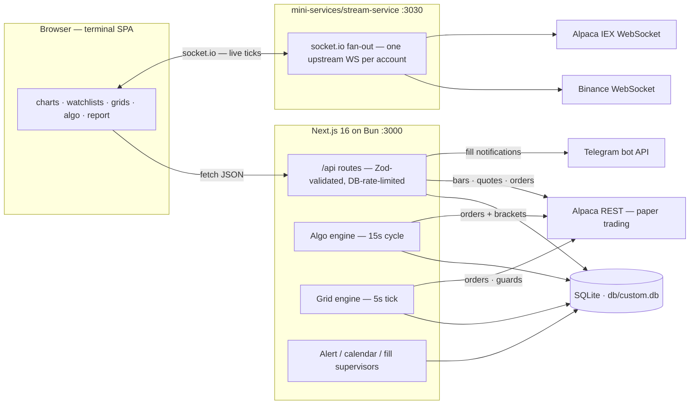

<div align="center">


# BLACKHOLE Terminal

**A self-hostable, TradingView-style trading terminal — charts, watchlists, algo trading, backtesting and live market data in one dark little universe.**

Paper trading · Algo engine · Backtests · Live crypto & US-equity data · Optional 2FA

`Next.js 16` · `TypeScript` · `Tailwind CSS 4` · `shadcn/ui` · `Prisma + SQLite` · `lightweight-charts` · `socket.io`

</div>

---

## What is this?

BLACKHOLE Terminal is a full trading workstation you can run on your own machine:

- **Multi-pane charts** (lightweight-charts) with drawings, symbol search and position markers
- **Watchlists, quotes and news** side panels
- **Order entry** with brackets / OCO / OTO and stop-loss management against **Alpaca** (paper trading recommended)
- **An algo engine** that runs your strategy rules live (start / stop / per-run settings) with Telegram fill notifications
- **Backtesting** — single runs, parameter optimization and "test all strategies" sweeps, plus watchlist-driven *Recommended Setups*
- **Economic calendar with alarms, heat map, positions, strategy orders and a report tab**
- **Real-time streaming** for crypto (Binance, keyless) and US equities (Alpaca), multiplexed over a single websocket per account

Everything is stored locally in a single SQLite file. No cloud, no telemetry, no fabricated prices — symbols without a live upstream simply don't stream.

## Architecture



Single-process by design for a personal workstation: engines run **in-process** with restart-resilient state (each run/grid row carries its own working memory in the DB, so a reboot resumes instead of re-asking). If you ever need process isolation for the algo engine, see [Roadmap](#roadmap).

## How the algo engine works

One supervisor loop, evaluated every **15 seconds** (`CYCLE_MS`), strictly on **last-closed bars** — no intrabar repaint, no double-fires:

1. **Resume** — on boot every `AlgoRun` in `status=running` re-hydrates its state from the DB (restart-safe).
2. **Gate** — equity runs with the RTH gate skip entries outside **09:30–16:00 ET** (constants live in [`src/lib/sessions.ts`](src/lib/sessions.ts) — DST handled via `Intl`); entries pause after **15:45 ET** and open positions flatten (EOD rule).
3. **Size** — each strategy converts a risk budget (USD) into a quantity via `riskSizedQty` — risk-money sizing, not "invest everything".
4. **Evaluate** — the strategy function sees the last-closed bar (plus indicator warm-up) and returns an entry/exit intent, normalized by `normalizeAlgoParams`.
5. **Execute** — entries go to Alpaca with bracket exits (`placeOrderWithExits`); crypto uses an OCO supervisor; every decision is journalled to `AlgoLog` with a heartbeat every 10 idle minutes.

The **grid engine** (`src/lib/grid-engine.ts`, 5s tick) is the same discipline: arithmetic/geometric levels, per-lot fills with realized-PnL attribution, whole-grid maxSL/maxTP guards (absolute price or percent basis), one-sided `buy`/`sell` directions, and `closeOnStop` market-closing every open lot when a guard trips. A pure replay of the same math backs the grid backtester (`simulateGridBacktest`) — covered by tests.

### Strategy quality toolkit (Task 12)

Shared by the backtest (`decide()`) and the live engine (`evalStrategy()`) from one module, [`src/lib/algo-regime.ts`](src/lib/algo-regime.ts), so a veto can never drift between backtest and live. Gates **fail open** on insufficient history (a thin bar window never freezes a strategy) and never touch exits:

- **Regime trend gate** (P0) — LONG only above the 200-SMA, SHORT only below; ships ON for the mean-reversion strategies.
- **ADX chop gate** (P0) — mean-reversion entries only while Wilder ADX(14) < `adxMax` (default 25); opt-in per strategy.
- **Half-life gate** (P1) — rolling Ornstein-Uhlenbeck fit of the close−SMA(50) deviation; entries only while the half-life is finite and ≤ `hlMax` bars (a trending deviation is vetoed).
- **ORB volume filter** (P2) — the breakout bar must carry ≥ `orbVolMult` × the opening-range average volume (0 = off).
- **Vol-scaled slippage** (P1, backtest) — the slippage impact scales with each bar's ATR% vs the dataset average, clamped 0.5–3×.
- **Walk-forward optimization** (P0, backtest) — rolling or anchored re-optimization across chronological folds, an OOS-distribution aggregate (robustness / median OOS / parameter stability), and a pure hold-out tail carved off before any tuning.
- **Monte Carlo bootstrap** (P2, backtest) — 1,000 seeded resamples of the realized trade sequence → p5/p50/p95 net%, P(loss), max-DD percentiles.
- **Optimizer plateau analysis** (P1) — ±1-grid-step neighbor re-runs of the winner; a verdict of "fragile peak" flags overfit optima.

All gates are plain strategy parameters (they flow through `normalizeAlgoParams`, the optimizer grids, config import/export and both UIs automatically); the new ones default conservatively and are covered by `tests/algo-quality.test.ts`.

## Keyboard shortcuts

Honest list — only shortcuts that actually exist (press **?** in the terminal to see this dialog):

| Keys | Action |
| --- | --- |
| `Alt + Shift + E` | Toggle extended-hours (pre/post-market) data on all charts |
| Right-click on a chart | Context menu — trade here, set an alarm, clone/delete a drawing, edit exits |
| Long-press ~0.5s (touch) | Same chart context menu on phones and tablets |
| `Esc` | Cancel an in-progress drawing drag, reset the drawing tool, close dialogs |
| `↑ / ↓` on a splitter | Nudge the Positions panel splitters (keyboard resize) |
| `?` | Open the shortcuts dialog |

Tabs drag to reorder; panels and splitters drag to resize.

## Requirements

| Tool | Version | Why |
| --- | --- | --- |
| [Bun](https://bun.sh) | ≥ 1.1 | Runtime + package manager (scripts call `bun` directly) |
| OS | Linux / macOS / WSL2 | `sqlite`, `bash` and a Caddy/nginx reverse proxy (optional) |

> Node.js is *not* required — Bun alone runs the app, the DB tooling and the streaming service.

## Quick start (≈ 5 minutes)

```bash
# 1 — clone & install
git clone https://github.com/iain504/blackhole_terminal.git
cd blackhole_terminal
bun install

# 2 — create the DB directory and configure the environment
mkdir -p db
cp .env.example .env

# generate two secrets (print each twice, paste into .env)
bun -e "console.log(require('crypto').randomBytes(32).toString('hex'))"

#   Minimum .env for local use:
#   DATABASE_URL=file:$PWD/db/custom.db      ← absolute path!
#   AUTH_SECRET=<32-byte hex from above>
#   APP_ENCRYPTION_SECRET=<32-byte hex from above>

# 3 — create the SQLite schema
bun run db:push

# 4 — run it
bun run dev                       # → http://localhost:3000
```

> **Why an absolute `DATABASE_URL`?** Prisma resolves relative `file:` URLs against `prisma/schema.prisma`, not the repo root — an absolute path avoids the classic "database file appears in the wrong folder" trap.

Open **http://localhost:3000** — the landing page's **Login** button takes you to the terminal.

## First run

1. **Create the first account** — a fresh install with an empty user table always allows the *first* registration (bootstrap), even with registration closed. After that, new signups are controlled by `ALLOW_REGISTRATION` (default: **off**).
2. **Enroll 2FA** — you'll be asked to scan a QR code with any TOTP authenticator (Google Authenticator, Aegis, 1Password…). Logins then require a 6-digit code.
3. **Add your Alpaca keys** — *Settings → Alpaca API keys*. Keys are validated with a live request and stored **encrypted at rest** (AES-256-GCM). They never reach the browser; the streaming service resolves them server-side from your session.

## Connecting market data & a broker

| Market | Data source | Keys needed |
| --- | --- | --- |
| Crypto (`BTC/USD`, `ETH/USD`, `SOL/USD`…) | Binance public REST + WebSocket | **None** — works out of the box |
| US equities & ETFs (`AAPL`, `TSLA`, `SPY`…) | Alpaca data API | Alpaca keys (the free IEX plan is enough) |
| Order execution | Alpaca trade API | Alpaca keys — **paper keys recommended** |

- Get free paper-trading keys at [alpaca.markets](https://alpaca.markets) → *Paper Trading* → *Generate keys*.
- Without Alpaca keys, equity charts fall back to clearly-labeled demo data; crypto keeps working fully.
- Alternatively, provide shared keys via env (`APCA_API_KEY_ID` / `APCA_API_SECRET_KEY`) and set `ALLOW_SHARED_BROKER=true` so users *without* their own keys can trade on them.

## Environment variables (`.env`)

| Variable | Default | Purpose |
| --- | --- | --- |
| `DATABASE_URL` | — (**required**) | SQLite path, e.g. `file:/abs/path/db/custom.db` |
| `AUTH_SECRET` | — (**required**, boot refuses without it) | HMAC-SHA256 session-cookie signing key (32-byte hex) |
| `APP_ENCRYPTION_SECRET` | falls back to `AUTH_SECRET`, then an auto-generated DB master | AES-256-GCM key for credentials at rest (Alpaca keys, TOTP secrets, Telegram tokens). **Set once and keep stable** — rotating it makes stored credentials undecryptable |
| `ALLOW_REGISTRATION` | `false` | Allow new signups after the first bootstrap account |
| `ALLOW_SHARED_BROKER` | `false` | Permit trading with the env-configured shared Alpaca keys when a user has none of their own |
| `APCA_API_KEY_ID` / `APCA_API_SECRET_KEY` | — | Optional *shared* Alpaca keys (paper recommended) |
| `ENABLE_METRICS` | `0` | `1` exposes `GET /api/metrics` (Prometheus text format) — keep off unless you scrape it |
| `LOG_LEVEL` | `info` | Structured JSON log level: `debug` / `info` / `warn` / `error` |
| `DEBUG_DB` | — | Set to `1` to log Prisma queries |

Full template with comments: [`.env.example`](.env.example).

## Real-time streaming (optional but nice)

The terminal streams live ticks through a small sidecar service (`mini-services/stream-service`, socket.io on **port 3030**) that multiplexes **one** Binance websocket and **one** Alpaca iex websocket per account (Alpaca allows only one market-data connection per key). Without it the terminal still works — the status chip shows **Polling** (REST fallback) instead of **Live**.

```bash
cd mini-services/stream-service
bun install
bun index.ts        # listens on :3030, pairs with the app on :3000
```

The browser connects to `/?XTransformPort=3030` **on the same origin** — so a reverse proxy must route that query to port 3030. The repo ships a matching [Caddyfile](Caddyfile); for a real domain it looks like this:

```caddyfile
your.domain.com {
    @stream query XTransformPort=3030
    handle @stream {
        reverse_proxy 127.0.0.1:3030
    }
    handle {
        reverse_proxy 127.0.0.1:3000
    }
}
```

No proxy at all? Everything works — you just get REST polling instead of live ticks.

## Production deployment

### Option A — Docker Compose (recommended)

```bash
docker compose up -d --build
```

Two services, both `restart: unless-stopped`, health-checked, and the **stream sidecar auto-starts** with the stack: `app` on **:3000** (SQLite bind-mounted at `./db`) and `stream` on **:3030** (socket.io). Secrets are read from the repo-root `.env` (`AUTH_SECRET` / `APP_ENCRYPTION_SECRET` are required). Schema is applied on every boot by the entrypoint's `prisma db push` — set `DB_PUSH_ACCEPT_DATA_LOSS=1` only if you knowingly ship destructive schema changes.

### Option B — Render.com (free tier)

The repo ships a Blueprint (`render.yaml`) — Dashboard → **New + → Blueprint → pick this repo → Apply**, then paste your Alpaca paper keys in the Environment tab. Render builds the same Dockerfile, injects `PORT`, generates stable `AUTH_SECRET` / `APP_ENCRYPTION_SECRET` once (`generateValue`), and health-checks `/api/health`. Bun runs JavaScriptCore (the V8-style heap flag is ignored), so JSC is steered via `BUN_JSC_forceRamSize` and the memory guard also watches **process RSS** against a 460MB ceiling — heavy analytics return the polite 503 before the 512MB free container gets silently OOM-killed.

Free-tier trade-offs (details in `render.yaml`): **ephemeral disk** (the SQLite file resets on every deploy/restart — persistence needs `plan: starter` + the commented disk block), **spin-down** after 15 idle minutes (grid/algo engines tick in-process, so they pause while asleep), and **no stream sidecar** (the terminal runs over REST polling; the Live chip shows amber). Always-on + persistence = `plan: starter` + disk.

**Troubleshooting — Prisma `Error code 14: Unable to open the database file`**: your Render service has a `DATABASE_URL` pointing outside the container (e.g. a dev path like `file:/home/z/my-project/db/custom.db`). The entrypoint self-heals since Task 13 (falls back to `file:/app/db/custom.db` with a loud boot log), but the clean fix is to delete the `DATABASE_URL` env var in the Render dashboard — the image default is identical — or set it to `file:/app/db/custom.db`, then redeploy. On Render, `DATABASE_URL` must always live under `/app`.

### Option C — systemd

```bash
bun run build        # next build (standalone output) + static asset copy
bun run start        # serves .next/standalone on :3000 (PORT env to override)
```

A minimal systemd unit pair:

```ini
# /etc/systemd/system/blackhole.service
[Unit]
Description=BLACKHOLE Terminal (Next.js)
After=network.target

[Service]
WorkingDirectory=/opt/blackhole_terminal
ExecStart=/usr/local/bin/bun run start
Restart=always
Environment=NODE_ENV=production
Environment=PORT=3000

[Install]
WantedBy=multi-user.target

# /etc/systemd/system/blackhole-stream.service
[Service]
WorkingDirectory=/opt/blackhole_terminal/mini-services/stream-service
ExecStart=/usr/local/bin/bun index.ts
Restart=always
```

Then `systemctl enable --now blackhole blackhole-stream` and put Caddy/nginx in front (see above).

> The full go-live walkthrough — secrets, rotation, backups, TLS, hardening, rollback — lives in [`docs/PRODUCTION_CHECKLIST.md`](docs/PRODUCTION_CHECKLIST.md).

## Observability

- **`GET /api/health`** — unauthenticated probe; `200 {status:'ok'}` or `503 {status:'degraded'}`. Non-sensitive payload: uptime, RSS/heap MB, db flag, active algo runs, active grid trades, recommendation age, stream status, rate-limit store (`db`/`memory`), version + git sha.
- **`GET /api/metrics`** — Prometheus exposition (optional, `ENABLE_METRICS=1`): uptime, memory, db_up, algo runs, grid trades, build info.
- **Structured logs** — server ops events emit single-line JSON (`{"t":…,"lvl":"warn","evt":"auth_login_failed","ip":…,"user":…}`) via `src/lib/logger.ts`; filter with `journalctl -u blackhole -o cat | grep '"evt":"auth_login_failed"'`. Level via `LOG_LEVEL`.

## Useful scripts

| Command | What it does |
| --- | --- |
| `bun run dev` | Dev server on `:3000` (logs to `dev.log`) |
| `bun run build` / `bun run start` | Production build / serve (standalone) |
| `bun run test` | Test suite (`bun test`) — TOTP RFC vectors, rate limiter, sessions, grid math, crypto-at-rest |
| `bun run db:push` | Apply `prisma/schema.prisma` to the SQLite file |
| `bun run db:generate` | Regenerate the Prisma client |
| `bun run lint` | ESLint (API routes enforce extra strictness: no implicit `any`) |
| `bun scripts/rotate-secrets.mjs --auth` / `--encryption` / `--all` | Rotate secrets — re-encrypts every stored credential, updates `.env` + DB master row (`--dry-run` to preview) |

## Troubleshooting

- **App refuses to boot** → `AUTH_SECRET` is missing from `.env`.
- **Equity charts show demo data / "no historical data"** → no Alpaca keys configured (crypto still works keyless).
- **Status chip says *Polling* instead of *Live*** → `stream-service` isn't running, or your reverse proxy doesn't map `?XTransformPort=3030` to port 3030.
- **SQLite file created in the wrong place** → `DATABASE_URL` must be an absolute `file:` path (see Quick start).
- **Heavy backtest sweeps on a small VPS** → sweeps are heap-guarded and will return a polite *503 / retry* rather than die; give the Node process ~2 GB (`NODE_OPTIONS=--max-old-space-size=1800`) for comfortable use. Recommended-setups refresh sweeps **your watchlist** (max 10 symbols × 3 timeframes).
- **Port 3000 busy** → `PORT=3001 bun run dev` won't help the dev script (it pins 3000); stop the other process or edit `package.json`.

## Security notes

- **Use paper-trading keys first.** This is a personal trading tool, not an audited exchange.
- Per-user broker keys, TOTP secrets and Telegram tokens are encrypted at rest with `APP_ENCRYPTION_SECRET`; session cookies are HMAC-signed.
- Login / registration / grid-mutation endpoints are rate-limited, and the counters are **persisted in the DB** (`RateLimitBucket`) — restarting the server no longer resets brute-force windows.
- The streaming sidecar authenticates every socket handshake against the app's session cookie — invalid sockets drop to a restricted guest mode (public crypto only).
- Never commit your real `.env` (`.gitignore` already excludes it). If a key ever leaks into git history, **rotate it** at the provider. To rotate the app's own secrets: `bun scripts/rotate-secrets.mjs --all` (see the script header for exactly what it touches).

## Project structure

```
src/app/            Next.js App Router (terminal page + /api routes)
src/components/     terminal UI (tabs, chart, sidebar, mobile shell), shadcn/ui, landing
src/lib/            domain logic: algo engine, backtest, indicators, alpaca/binance
                    clients, auth + TOTP, crypto-at-rest, memory guards
mini-services/      stream-service (socket.io live ticks, port 3030)
prisma/             schema.prisma (SQLite)
db/                 custom.db (created by db:push, git-ignored)
```

## Scaling beyond SQLite

SQLite is the right call for a single user — but if you outgrow it (multiple users, heavy bar ingestion), two paths are documented: [PostgreSQL](docs/DATABASE_MIGRATION.md) (provider swap + ETL) and [Turso](docs/DATABASE_MIGRATION.md) (libSQL adapter, schema stays SQLite-compatible).

## Roadmap

Deliberate non-goals of the current architecture, kept visible instead of forgotten:

- **Algo engine worker isolation** — the engine runs in-process; extracting it to an optional worker (`ALGO_WORKER=1` child process or a separate service) would isolate a wedged cycle from HTTP, at the cost of IPC for state that is currently a simple DB read. Worth doing if you run long backtests while trading live.
- **Mobile layout depth** — the terminal shell collapses on small screens and the chart context menu works by long-press, but dense panels (grid ladders, reports) are still desktop-first.
- **Richer test coverage** — the suite covers the security and math cores (TOTP, crypto, rate limiting, sessions, grid serialization + backtest replay); auth-flow integration tests and API-route contract tests are the natural next layer.

## Disclaimer

This project is for **personal, educational use**. Nothing in it is financial advice. Trading involves risk — run it against Alpaca **paper** accounts until you fully trust your configurations.

---

<div align="center">
<sub>Built with Next.js 16, TypeScript, Tailwind CSS 4, shadcn/ui, Prisma, lightweight-charts and socket.io.</sub>
</div>
